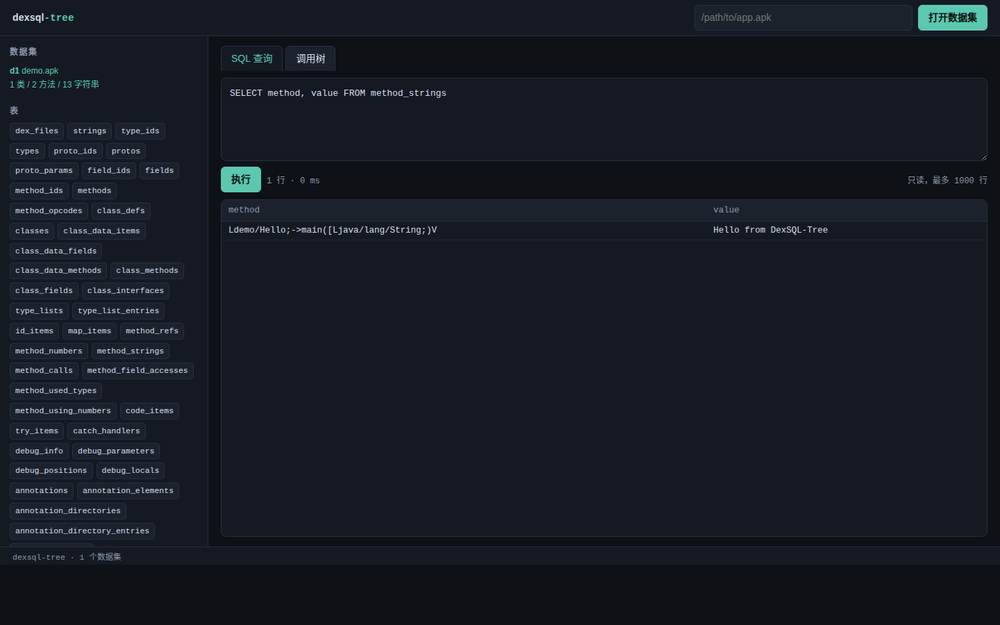

# dexsql-tree

用 SQL 查询 Android APK / DEX，并把调用关系展开成树。**Go 引擎 + Java 客户端**，MIT 许可，完全开源。

开发者：**ByUsi Studio**。

> 目标不是复刻一个二进制，而是复刻一种工作方式：把 `classes.dex` 里的类、方法、字符串、字段访问、调用点当作关系表，让分析者用一条 SQL 回答"谁引用了这个字符串、谁调用了它、它又调用了谁"。

```bash
dexsql-tree query --input app.apk \
  --sql "SELECT method, value FROM method_strings WHERE value LIKE '%api.example.com%'"

dexsql-tree tree --input app.apk \
  --method 'Lcom/example/Auth;->login(Ljava/lang/String;)V' --direction callers --depth 3
```

---

## 1. 为什么会有这个项目

LSPosed 的 [DexSQL](https://github.com/LSPosed/dexsql-release) 证明了"DEX 当数据库查"是非常高效的分析范式，但它本身是**闭源软件**，只以二进制形式发布，使用 [DexSQL Binary License 1.0](https://github.com/LSPosed/dexsql-release/blob/master/LICENSE)：可以免费使用和再分发二进制，但拿不到源码，也无法审计解析逻辑、扩展表结构或嵌入自己的产品。

`dexsql-tree` 是一个独立的、clean-room 的开源实现：

| | DexSQL（LSPosed） | dexsql-tree |
| --- | --- | --- |
| 源码 | 闭源 | 全部开源（MIT） |
| 解析层 | 原生实现，自描述为直接读 DEX、复用已加载数据集 | Go 实现，按 DEX 规范逐节解码 |
| 查询层 | 内置只读 SQL 子集 + 列式存储 | SQLite（纯 Go 驱动 `modernc.org/sqlite`），完整 SQL |
| 分发 | 单文件二进制 + MCP | 单文件二进制 + MCP + HTTP API + JavaFX 桌面端 |
| 调用链 | 通过 SQL 自连接 | 额外提供 `tree` 子命令和 `/api/tree`，带环检测与深度限制 |
| 许可 | Binary License（禁止获取源码） | MIT |

**没有复制 DexSQL 的任何代码或资源。** 表名与列名对齐其公开文档（文档本身是 MIT），目的是降低迁移成本；实现、数据结构与查询方式完全不同。

更详细的原项目拆解见 [docs/analysis-dexsql.md](docs/analysis-dexsql.md)。

---

## 2. 架构


职责划分：

- **Go**：所有二进制解析、SQL 物化、调用图、协议适配。无 CGO，交叉编译简单。
- **Java**：只做展示与集成。`dexsql-tree-client` 是一个零依赖（除 Jackson）的 HTTP 客户端；`dexsql-tree-gui` 是 JavaFX 桌面端。
- 两个语言共用同一个 HTTP 契约，保证 CLI、MCP、GUI 的查询结果完全一致。

详细设计见 [docs/architecture.md](docs/architecture.md)。

---

## 3. 快速开始

### 3.1 构建 Go 引擎

需要 Go 1.21+。

```bash
git clone <this-repo> dexsql-tree
cd dexsql-tree
go build -o bin/dexsql-tree ./cmd/dexsql-tree

# 生成一个 672 字节的演示 DEX/APK（源码在 internal/dextest）
go run ./cmd/dexgen -out testdata
```

验证：

```bash
./bin/dexsql-tree query --input testdata/demo.apk \
  --sql "SELECT descriptor, access_flags FROM methods"
```

输出：

```
descriptor                                           access_flags
---------------------------------------------------  ------------
Ldemo/Hello;->main([Ljava/lang/String;)V             9
Ljava/io/PrintStream;->println(Ljava/lang/String;)V  NULL
```

`NULL` 的含义是这个 DEX 只**引用**了该方法，没有定义它。这也是 DexSQL 数据模型里"引用 vs 定义"的核心区分。

### 支持的平台

引擎不依赖 cgo（SQLite 使用纯 Go 实现），所以全部平台可由一条命令交叉编译：

```bash
make release          # 产物写入 dist/dexsql-tree-<版本>/
```

| 平台 | 架构 | 目录 |
| --- | --- | --- |
| Linux | x86-64 / ARM64 / ARMv7 | `linux-amd64`、`linux-arm64`、`linux-armv7` |
| macOS | Intel / Apple Silicon | `darwin-amd64`、`darwin-arm64` |
| Windows | x64 / ARM64 | `windows-amd64`、`windows-arm64` |
| FreeBSD | x86-64 / ARM64 | `freebsd-amd64`、`freebsd-arm64` |

ARM64 覆盖服务器（Ampere/Graviton）、树莓派 4/5 的 64 位系统、Apple Silicon 与 Windows on ARM；ARMv7 供树莓派 2/3 等 32 位设备使用。脚本同时生成 `sha256sums.txt` 与演示 APK，便于解压即测。

### 3.2 构建 Java 客户端与桌面端

需要 JDK 20+ 与 Maven 3.9+。

```bash
cd java
mvn install                    # 编译 client 与 gui、运行测试并安装到本地仓库
mvn -pl dexsql-tree-gui javafx:run \
  -Ddexsql.tree.bin=../bin/dexsql-tree \
  -Ddexsql.args="--input ../testdata/demo.apk"
```

桌面端也可以连接已经在运行的引擎：

```bash
./bin/dexsql-tree serve --input app.apk --addr 127.0.0.1:8765
mvn -pl dexsql-tree-gui javafx:run -Ddexsql.args="--connect http://127.0.0.1:8765"
```

### 3.3 内置 Web Playground

```bash
./bin/dexsql-tree serve --input app.apk
# 打开 http://127.0.0.1:8765
```

页面提供表目录、SQL 编辑器（Ctrl+Enter 执行）和调用树视图，不依赖任何 CDN。




---

## 4. CLI

| 命令 | 用途 |
| --- | --- |
| `query --input X --sql "..."` | 执行一条只读 SQL；`--limit`（默认 200，`0` 为全部）、`--format table\|json\|csv\|md`、`--output` |
| `query --input X --recipe callers --arg method=D` | 跑内置查询模板，不用写 SQL |
| `query --input X` | 终端交互式 REPL（`.tables`、`.schema methods`、`.quit`） |
| `search --input X --keyword 关键词` | 一次搜类、方法、字段、字符串；`--kind` 可限定范围；直接扫模型，不建 SQLite |
| `stats --input X [--json]` | 一屏总览：文件、类、方法、调用点、最大的类 |
| `recipes [名称]` | 列出内置模板，给名称时打印 SQL 与参数 |
| `tables [--json]` | 列出 56 张表与 3 个便捷视图 |
| `tree --input X --method D` | 调用树；`--direction callers\|callees`、`--depth`、`--format text\|json\|dot` |
| `smali --input X --method D` | 反汇编单个方法 |
| `serve --input X [--addr ...]` | HTTP API + Web UI |
| `mcp [--input X]` | stdio MCP 服务器 |
| `cache list\|clear\|path\|info` | 管理磁盘目录缓存 |
| `lang set zh --write` | 把中文提示写入 shell 启动文件 |

### 中文提示

CLI 的所有提示、帮助、报错和表格单位都支持中英双语。切换方式有三种，优先级从高到低：

```bash
DEXSQL_TREE_ZH=true dexsql-tree stats --input app.apk   # 本次调用
dexsql-tree --lang zh tables                            # 本次调用（命令行开关）
dexsql-tree lang set zh --write                         # 永久写入 ~/.zshrc 等启动文件
```

- 变量名是 `DEXSQL_TREE_ZH`，值为 `true`/`1`/`yes`/`on`/`zh` 时启用中文；`false`/`0`/`en` 保持英文。
- 同时接受带连字符的 `DEXSQL-TREE_ZH`（部分 `.env` 工具会保留连字符）以及 `DEXSQL_TREE_LANG=zh|en`。
- 语言只由变量或开关决定，不读取系统 locale，脚本输出因此可复现。

`lang` 子命令：

| 命令 | 行为 |
| --- | --- |
| `lang` / `lang show` | 显示当前语言、来源变量、启用/关闭命令、启动文件路径 |
| `lang set zh` / `lang set en` | 打印对应 shell 的赋值语句；加 `--write` 写入启动文件 |
| `lang unset` | 打印清除变量的语句；加 `--write` 删除写入过的配置块 |
| `lang env` | 只输出赋值语句，便于 `eval "$(dexsql-tree lang env)"` |
| `lang path` | 打印将要修改的启动文件 |

`--shell bash|zsh|fish|powershell|cmd` 可覆盖自动检测；`--file 路径` 可指定任意文件。写入使用带标记的配置块，重复执行不会重复追加，`unset --write` 会整块移除。

### 简化查询：视图与模板

大多数问题不需要写 JOIN。打开数据后有三层递进的捷径：

```sql
-- 1) 视图：方法已带 Java 类名和常用访问标志
SELECT java_class, name, opcode_count FROM v_methods WHERE name LIKE '%password%';

-- 2) 概览视图：一条语句看清各表规模
SELECT * FROM v_overview;
```

```bash
# 3) 模板：参数化查询，CLI / HTTP / MCP 共用同一份 SQL
dexsql-tree query --input app.apk --recipe callers \
  --arg method='Lcom/example/Foo;->bar(I)V'

dexsql-tree recipes callers       # 查看参数与展开后的 SQL
dexsql-tree recipes               # 全部模板
```

内置模板：`callers`、`callees`、`methods-like`、`strings-like`、`api-usage`、`class-info`、`big-methods`、`urls`。参数会被安全转义，注入的多语句会被只读守卫拒绝。

### 打开速度：缓存与档位

打开一个大包只做一次，重复查询是常态。`--cache` 把物化结果留在磁盘上，第二次打开直接从目录挂载：

```bash
dexsql-tree query --input vlc.apk --cache --sql "SELECT count(*) FROM methods"
# 首次 32.7 s；同一条命令再跑一次 0.55 s

dexsql-tree cache list          # 缓存了什么、占多少空间
dexsql-tree cache info --input vlc.apk
dexsql-tree cache clear         # 全部删掉
```

缓存键包含路径、大小、修改时间、引擎版本、档位、`--debug` 与**这次查询读到的表集合**，所以换了文件、设置或查询范围会自动重建，不会读到旧数据；同一个输入的不同表集合会显示成同一个键前缀下的多个目录。默认位置是系统缓存目录，可用 `DEXSQL_TREE_CACHE` 或 `--cache-dir` 覆盖。

`--profile` 控制物化多少：

| 档位 | 内容 | 用途 |
| --- | --- | --- |
| `fast`（默认） | 实体、引用、字节码、调用点、静态字段初值；不写 `method_refs`、`method_using_numbers`、`id_items` 三张派生表 | 找类、找方法、看调用关系、查字符串 |
| `full` | 再加上注解、注解元素、参数注解 | 需要读 `@Keep`、`@JsonProperty`、R8 注解等 |

两档的**表结构完全一致**，区别只是注解相关表有没有行。需要注解时加 `--profile full` 即可，其余查询不用改。

`--jobs N` 控制多 DEX 的解析并行度，默认等于 CPU 核数；`--disk` 把目录放在临时文件里，用时间换内存。

### 只物化要查的表

0.4.0 起，打开时不再写满 56 张表。引擎先从 SQL 里做一次词法扫描（跳过注释、字符串字面量与不认识的标识符），把视图展开成基表，然后只建这几张：

```bash
dexsql-tree query --input app.apk --sql "SELECT count(*) FROM method_calls"
# 0.4.0：K-9 上 2.6 s / 556 MB；0.3.0 同一条查询 11.2 s / 1.34 GB
```

边界与代价：

- 计划是**词法**的，不是 SQL 解析器。CTE 或别名撞上表名只会多建一张，不会漏；语句里没有任何表名时（`SELECT 1`）什么也不建，由 SQLite 报 `no such table`，不会静默返回 0 行。
- 目录是为**一组表**建的，所以缓存键包含表集合。已有的完整目录可以回答它的任何子集查询；反过来，只建了两张表的目录不会被拿去回答五张表的查询。
- 需要绕过计划（交互式随便查、调试）时加 `--all-tables`。
- `fast` 档默认跳过三张派生表：`method_refs` 是其余引用表的超集，`method_using_numbers` 与 `method_numbers` 重复，`id_items` 只有取证级查询用。语句点名它们时仍会构建，因此不会出现"查到 0 行"的静默错误。
- 表达式里的 `SELECT *` 不需要特殊处理：`FROM` 后面的基表一定会被识别，星号只影响列，不影响表。

两个开关控制"打开时做什么"：

| 开关 | 作用 | 何时使用 |
| --- | --- | --- |
| `--disk` | 把目录物化到系统临时文件，退出时删除 | 大 APK 或内存紧张；内存通常降到 1/2–1/3，耗时基本不变 |
| `--debug` | 额外写入 `debug_positions` / `debug_locals` | 需要行号、局部变量；这些表往往比代码本身大，默认关闭 |

`--input` 可以重复，多个 APK/DEX 会被合并到一个 `file_id` 空间：

```bash
./bin/dexsql-tree query --input base.apk --input split_config.dex \
  --sql "SELECT file_id, count(*) FROM classes GROUP BY file_id"
```

### 常用查询

```sql
-- 1. 谁引用了这个 URL（也可以直接 search --keyword api.example.com）
SELECT method, value FROM method_strings
WHERE value LIKE '%api.example.com%';

-- 2. 这个方法的直接调用者（等价于 --recipe callers）
SELECT method, count(*) AS sites FROM method_calls
WHERE callee = 'Lcom/example/Foo;->bar(I)V'
GROUP BY method ORDER BY sites DESC;

-- 3. 两跳调用者
SELECT c1.method AS caller, c2.method AS caller_of_caller
FROM method_calls c1
JOIN method_calls c2 ON c2.callee = c1.method
WHERE c1.callee = 'Lcom/example/Foo;->bar(I)V';

-- 4. 字符串 + 调用关系联合过滤
SELECT DISTINCT c.method
FROM method_strings s
JOIN method_calls c ON c.method = s.method
WHERE s.value LIKE '%token%'
  AND c.callee LIKE '%HttpURLConnection;->connect%';

-- 5. 某个类自己声明的方法与访问标志
SELECT method_name, kind, access_flags
FROM class_methods WHERE class_descriptor = 'Lcom/example/Foo;';

-- 6. 带注解的类
SELECT owner, annotation, element_name, value_i64
FROM annotation_elements_resolved
WHERE owner_kind = 'class' AND annotation = 'Lkotlin/Metadata;';
```

完整关系清单：[docs/schema.md](docs/schema.md)，更多语句见 [examples/queries.sql](examples/queries.sql)。也可以随时运行 `dexsql-tree tables` 查看二进制内置的目录。

> 注意：`method_refs` 有一列名为 `index`，它是 SQLite 关键字，查询时必须写成 `"index"`。

### 调用树

```bash
./bin/dexsql-tree tree --input app.apk \
  --method 'Ljava/io/PrintStream;->println(Ljava/lang/String;)V' \
  --direction callers --depth 2
```

```
callers of Ljava/io/PrintStream;->println(Ljava/lang/String;)V (depth 2, 2 nodes)
Ljava/io/PrintStream;->println(Ljava/lang/String;)V
└─ Ldemo/Hello;->main([Ljava/lang/String;)V
```

`--format dot` 可直接喂给 Graphviz；`--format json` 供程序消费。

---

## 5. MCP

```json
{
  "mcpServers": {
    "dexsql-tree": {
      "command": "/absolute/path/to/dexsql-tree",
      "args": ["mcp", "--input", "/absolute/path/to/app.apk"]
    }
  }
}
```

工具：

| 工具 | 作用 |
| --- | --- |
| `open_dataset` | 打开 APK/DEX，返回 dataset id 与统计 |
| `list_datasets` | 当前会话的数据集 |
| `list_tables` / `describe_table` | 表目录与列定义 |
| `query` | 只读 SQL，默认最多 200 行 |
| `search` | 关键词搜索类/方法/字段/字符串，免写 SQL |
| `describe_input` | 不建目录，只报输入的规模 |
| `run_recipe` / `list_recipes` | 运行内置参数化查询 |
| `call_tree` | 调用者/被调用者树 |
| `smali` | 单方法反汇编 |

协议为 JSON-RPC 2.0、按行分隔，支持 `initialize`、`tools/list`、`tools/call`、`ping`。

---

## 6. HTTP API

| 方法 | 路径 | 说明 |
| --- | --- | --- |
| GET | `/api/health` | `{ok, version, lang, profile, cache}` |
| GET | `/api/datasets` | 已加载数据集与统计 |
| POST | `/api/datasets` | `{path}`，解析并注册 |
| GET | `/api/tables` | 表与视图及列 |
| GET | `/api/table?name=methods` | 单个关系定义 |
| GET | `/api/recipes[?name=callers]` | 内置模板目录或单个模板 |
| GET | `/api/search?keyword=X&kind=class` | 关键词搜索，免写 SQL |
| GET/DELETE | `/api/cache` | 缓存状态 / 清空 |
| POST | `/api/query` | `{sql, limit, dataset}` 或 `{recipe, args, limit, dataset}` |
| POST | `/api/tree` | `{method, direction, depth, maxNodes, dataset}` |
| GET | `/api/smali?method=...` | 反汇编文本 |

所有接口允许跨域，`dataset` 省略时使用唯一已加载的数据集。服务是**懒物化**的：打开时不建表，第一次查询才补上它读到的表，所以启动只需解析时间。默认只监听 `127.0.0.1` 且不要求鉴权；需要对外时加 `--token`：

```bash
./bin/dexsql-tree serve --input app.apk --addr 0.0.0.0:8765 --token s3cret
curl -H "Authorization: Bearer s3cret" http://host:8765/api/health
# 浏览器打开 http://host:8765/?token=s3cret
```

Java 调用示例：

```java
try (DexsqlProcess engine = DexsqlProcess.start(Path.of("bin/dexsql-tree"), Path.of("app.apk"))) {
    DexsqlClient client = engine.client();
    QueryResult r = client.query("SELECT descriptor FROM classes LIMIT 10");
    for (List<Object> row : r.rows()) {
        System.out.println(row.get(0));
    }
    CallTree tree = client.tree("Lcom/example/Foo;->bar(I)V", Direction.CALLERS, 3);
}
```

---

## 7. 目录结构

```
dexsql-tree/
├── cmd/
│   ├── dexsql-tree/       CLI 入口（query/search/stats/recipes/tables/tree/smali/serve/mcp/lang）
│   └── dexgen/            生成演示 DEX/APK
├── internal/
│   ├── dex/               DEX 解析、指令解码、debug_info、注解、smali、APK 读取
│   ├── store/             SQLite 物化、56 张表、视图、查询模板、只读守卫
│   ├── cache/             磁盘目录缓存（键、列表、清理、残留回收）
│   ├── tree/              调用图、树构建、环检测、DOT 输出
│   ├── api/               HTTP API 与内置 Playground
│   ├── mcp/               stdio MCP 服务器
│   ├── i18n/              中英文案与环境变量/开关解析
│   └── dextest/           合成 DEX 构造器（测试与演示共用）
├── scripts/
│   └── build-all.sh       9 个平台目标的交叉编译 + 校验和
├── java/
│   ├── dexsql-tree-client/ HTTP 客户端、模型、进程管理、集成测试
│   └── dexsql-tree-gui/    JavaFX 桌面端
├── docs/                  原项目分析、架构、SQL 参考、Java 指南
└── testdata/              demo.dex / demo.apk（由 dexgen 生成）
```

---

## 8. 实现范围与已知限制

**已实现**

- DEX 035–041 常用节：字符串池、type/proto/field/method id、class_def、class_data、code_item、try/catch、debug_info、注解目录与编码值、method_handle、call_site、map_list、encoded_array、hiddenapi 标志表。DEX 041 容器会拆成多个逻辑 DEX（`classes.dex#2`），`file_id` 保持稳定。
- MUTF-8 解码（含 U+0000 与代理对）、Java 风格类型名、Dalvik 指令长度与引用提取、常量提取、smali 文本。
- 56 张关系表，覆盖实体、引用、字节码、注解、调试信息、隐藏 API 与 DEX 结构；另有 `v_methods`、`v_fields`、`v_overview` 三个便捷视图。
- 8 个内置查询模板（调用者、被调用者、API 使用量、最大方法、疑似凭据字符串等），CLI/HTTP/MCP 共用。
- 调用图（按调用点计数）与带环检测的树视图。
- 中英双语 CLI（`DEXSQL_TREE_ZH`）、关键词搜索与一屏统计。
- 磁盘目录缓存（`--cache`）、两档物化（`--profile fast|full`）与按表按需物化。
- 多 DEX 并行解析（`--jobs`）与 8 行定宽批量插入。
- 只读保护：`PRAGMA query_only=ON` + 语句白名单；`serve --token` 可选鉴权。
- DEX 解析器有 fuzz 目标，头部计数全部先做边界检查。
- 9 个交叉编译目标，覆盖 amd64/arm64/armv7。

**性能（Linux x64，`--profile fast`，冷启动，无 `--cache`）**

0.3.0 的每一行都是"打开即写满"，所以同一份样本上任何查询都是一个数；0.4.0 的数字取决于查询读到哪几张表。

| 样本 | 体积 | 方法数 | 0.3.0 任意查询 | 0.4.0 `methods` | 0.4.0 `method_calls` |
| --- | ---: | ---: | --- | --- | --- |
| F-Droid `com.fsck.k9` | 11 MB | 64,586 | 11.7 s / 1.34 GB | **0.79 s / 282 MB** | **2.6 s / 556 MB** |
| F-Droid `org.videolan.vlc` | 46 MB | 270,153 | 31.8 s / 3.52 GB | **2.34 s / 1.07 GB** | **5.7 s / 1.69 GB** |

`SELECT 1` 在 K-9 上 0.36 s / 207 MB：只解析、不建表。全量（`--all-tables`）仍是 10.4 s / 927 MB，比 0.3.0 快 11%，来自索引精简、16 KiB 页与写入路径。`--cache` 命中的数字不变（亚秒级）。

0.3.0 时期的单项收益（保留作对照）：

| 改动 | 效果 |
| --- | --- |
| 8 行定宽批量插入 | 16.7 s → 11.6 s（-30%）。批次更大反而变慢：每个绑定参数有一次反射开销 |
| `--profile fast` 跳过注解表 | VLC 39.4 s → 32.7 s（-17%） |
| 多 DEX 并行解析（6 dex） | 33.3 s → 30.9 s（-7%）；解析只占小包总时间的 3–5% |
| `--cache` | 12.0 s → 0.44 s（25 倍以上） |

0.4.0 的增量：

| 改动 | 效果 |
| --- | --- |
| 按需物化 | K-9 `methods` 11.7 s → 0.79 s（14.8 倍）；VLC `methods` 31.8 s → 2.34 s（13.6 倍） |
| 精简索引（只留等值匹配的 6 个） | 全量 K-9 11.7 s → 10.4 s（-11%），库文件少 18 MB 量级 |
| `page_size=16384` | 同数据 2.90 s → 2.68 s，文件 195.8 MB → 190.1 MB（K-9 `method_calls` 目录） |
| 热点表改用可复用 `[]any` | 单阶段写入 1.54 s → 1.37 s（-11%） |
| 物化后释放模型 | `query` 子命令峰值 RSS 约降 1/4 |

行号表（`--debug`）现在也按需：不查 `debug_positions` 就不会写。K-9 有 725 万条 position，只有语句点名调试表时才付这份代价。

**当前限制（请按需评估）**

1. **单表仍然线性**：按需物化解决的是"写太多表"，不是"单表太大"。读 `method_calls` 仍要把 30 万级调用点写进 SQLite，VLC 上约 5.7 s / 1.69 GB。再往下需要列式布局或流式执行器，那是另一个量级的工程。
2. **全量场景没有变快一个数量级**：`--all-tables` 或 `--profile full` + 大范围查询仍在 10–30 s；这是刻意保留的逃生口，不是默认路径。
3. **`hiddenapi_flags` 是保守解析**：按 class_defs 顺序读 uleb128，遇到越界即停止并记 warning；测试覆盖了截断与非法长度，但未在大量商业包上做过统计校验。
4. **大样本以开源 APK 验证**：已覆盖 6 个 DEX、39 MB 的 VLC，但未做商业加固/混淆包的基准。
5. **JavaFX 桌面端未在真实显示器上做交互回归**：分页、取消、内联报错的逻辑有编译与端到端验证，但没有在物理显示器上逐项点过。
6. SQLite 关键字冲突：`method_refs."index"` 需要引号。

**路线图**

- **新手体验**（下一版重点，见 [docs/roadmap-0.5.0.md](docs/roadmap-0.5.0.md)）：`start` 子命令、任务导向模板、错误附带建议、GUI 示例卡片
- 注解按需：`full` 档也只在语句引用注解表时展开
- `debug_positions` 打包：一个方法一行 + varint 二进制块，把 725 万行降到 6.8 万行（`--debug` 专用）
- 覆盖方法/字段的 override 关系展开（当前只按字节码直接引用）
- 模板与视图继续扩充（xref 汇总、签名对比）
- JavaFX：SQL 语法高亮、结果导出 CSV、深色/浅色主题切换

---

## 9. 开发

```bash
make test          # go test ./... + mvn test
go test ./internal/dex -run=^$ -fuzz=FuzzParseContainer -fuzztime=5m   # 解析器模糊测试
make build         # Go 二进制（带版本号）
make release       # 交叉编译 9 个平台到 dist/
make cross         # 快速验证 ARM64 目标可编译
make demo          # 生成 testdata 并跑一组演示查询
make fmt           # gofmt
```

CI 配置见 `.github/workflows/ci.yml`：一个 job 跑测试，一个矩阵 job 编译 9 个平台目标，一个 job 跑 Maven（含真实启动 Go 二进制的集成测试）。

## 10. 许可

MIT，Copyright (c) 2026 **ByUsi Studio**。见 [LICENSE](LICENSE)。

DEX 格式与 SQL 表命名参考了 Android 官方文档与 DexSQL 的公开文档（MIT）；未使用 DexSQL 的二进制或源代码。
