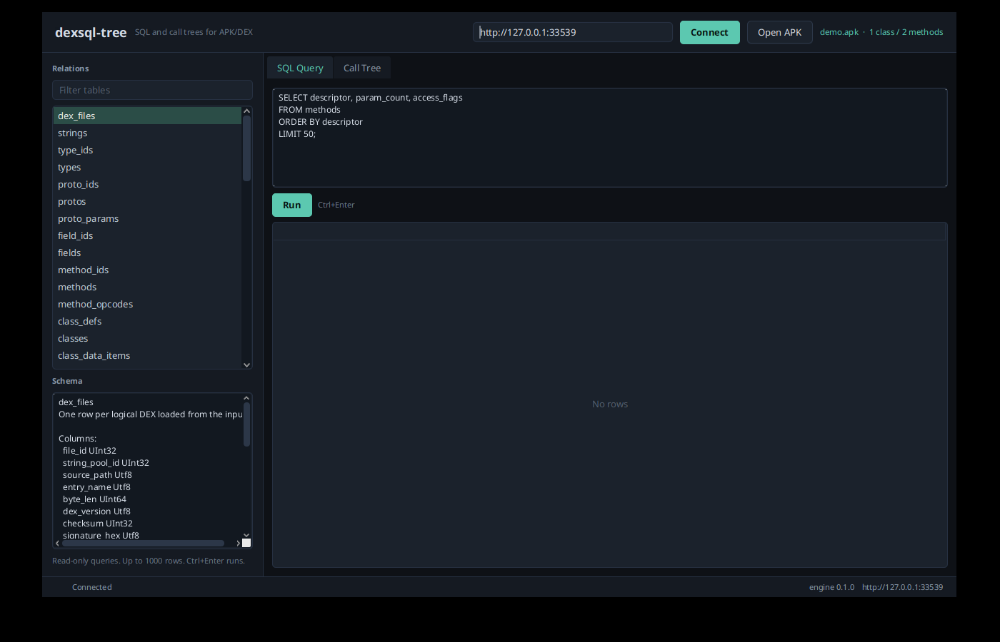

# Java 客户端与桌面端

## 1. 模块

| 模块 | 依赖 | 作用 |
| --- | --- | --- |
| `dexsql-tree-client` | Jackson | HTTP 客户端、数据模型、本地引擎进程管理 |
| `dexsql-tree-gui` | client + JavaFX 20 | 桌面端：表目录、SQL、调用树、smali |

要求 JDK 20+（record、`HttpClient`、switch 表达式）。

```bash
cd java
mvn install     # 安装到本地仓库，后续 javafx:run 才能解析 client 依赖
```

产物：

- `dexsql-tree-client/target/dexsql-tree-client-0.3.0.jar`
- `dexsql-tree-gui/target/dexsql-tree-gui-0.4.0.jar`

## 2. 用现成引擎

```java
DexsqlClient client = new DexsqlClient("http://127.0.0.1:8765");
client.useDataset("d1");                       // 可选：多数据集时指定

QueryResult r = client.query("""
        SELECT descriptor, access_flags
        FROM methods
        WHERE name = 'onCreate'
        LIMIT 20
        """);
```

引擎用 `serve --token SECRET` 启动时，把 token 传进构造函数即可，每个请求都会带上 `Authorization: Bearer`：

```java
DexsqlClient client = new DexsqlClient("http://127.0.0.1:8765", Duration.ofMinutes(5), "SECRET");
```

GUI 顶栏的地址输入框右侧有一个 `token` 输入框，连不上时先确认两边是否一致。

`QueryResult`：

```java
List<String> columns   // 列名
List<List<Object>> rows // 值：String / Long / Double / null
int rowCount
boolean truncated
long elapsedMs
```

`cell(row, col)` 是便捷方法，越界返回 null。

## 2.1 并发与异步

客户端本身无共享可变状态（`useDataset` 只是给省略 `dataset` 的调用提供默认值），并内置一个 2–8 线程的 daemon 池：

```java
// 三个请求同时飞，互不阻塞
CompletableFuture<QueryResult> a = client.queryAsync(sql1, 500, "d1");
CompletableFuture<QueryResult> b = client.queryAsync(sql2, 500, "d1");
CompletableFuture<CallTree> c = client.treeAsync(desc, Direction.CALLERS, 3, "d1");

CompletableFuture.allOf(a, b, c).join();
```

- `DexsqlClient.executor()` 是同一个池，GUI 的 `Task` 也跑在上面，线程数见 `poolSize()`。
- 取消用 `future.cancel(true)` 或 `Task.cancel(true)`：中断会打断阻塞中的 HTTP 请求，客户端抛 `DexsqlException("cancelled")`。
- 需要确定性顺序时传显式 `dataset`，不要依赖 `useDataset`。

## 2.2 搜索、模板与缓存

```java
QueryResult hits = client.search("oauth", List.of("class", "method"), 50, "d1");
QueryResult callers = client.recipe("callers", Map.of("method", desc), 200, "d1");

Health h = client.healthInfo();        // version / lang / profile / cache
CacheInfo cache = client.cache();      // dir / count / bytes / entries
client.clearCache();
```

## 3. 让 Java 管理引擎

```java
try (DexsqlProcess engine = DexsqlProcess.start(
        Path.of("bin/dexsql-tree"), Path.of("app.apk"))) {

    DexsqlClient client = engine.client();
    System.out.println(engine.port());
    System.out.println(client.datasets().get(0).stats().methods());
}
```

`start` 会：

1. 选择一个空闲的 loopback 端口；
2. 把引擎 stdout/stderr 重定向到临时日志；
3. 轮询 `/api/health`，最多等 30 秒；
4. 进程提前退出时抛出 `IOException`，并附上日志末尾 20 行。

关闭时先 `destroy()`，5 秒后强制终止。GUI 在 `Application.stop()` 中调用它。

二进制解析顺序：

1. `-Ddexsql.tree.bin=/path/to/dexsql-tree`
2. 环境变量 `DEXSQL_TREE_BIN`
3. 当前目录的 `./dexsql-tree`
4. `PATH` 中的 `dexsql-tree` / `dexsql-tree.exe`

## 4. 调用树

```java
CallTree tree = client.tree("Lcom/example/Foo;->bar(I)V", Direction.CALLERS, 3);
CallNode root = tree.root();
for (CallNode child : root.children()) {
    System.out.println(child.depth() + " " + child.descriptor()
            + " x" + child.calls() + (child.cycle() ? " [cycle]" : ""));
}
```

字段说明：

| 字段 | 含义 |
| --- | --- |
| `descriptor` | 完整方法描述符 |
| `className` | 所属类（JSON 里是 `class`） |
| `depth` | 相对根的层数 |
| `calls` | 父节点到该节点的调用点数 |
| `cycle` | 该节点在当前路径上已出现 |
| `fileId` / `methodIdx` | 可回查 `code_items`、`smali` |

## 5. 错误处理

所有失败统一抛 `DexsqlException`：

- `status()` 为 HTTP 状态码（网络层失败为 0）；
- 引擎返回的 `{"error": "..."}` 会被提取成 message；
- 中断会恢复线程中断标志。

```java
try {
    client.query("SELECT bad");
} catch (DexsqlException e) {
    System.err.println(e.status() + ": " + e.getMessage());
}
```

## 6. 线程模型

- `DexsqlClient` 可跨线程使用；只有 `datasetId` 是 `volatile` 可变状态。
- 每次调用是同步阻塞的，超时默认 5 分钟；需要取消时请中断线程。
- JavaFX 端所有调用都放在 `Task` 中，避免阻塞 UI 线程。

## 7. 桌面端

`org.dexsqltree.gui.DexsqlTreeApp`：

- 顶部：连接地址、打开 APK；
- 左侧：表目录与列定义；
- 中间：SQL 标签页（动态列、NULL 灰显）、调用树标签页（双击节点看 smali）；
- 底部：状态与耗时。

参数：

```bash
# 连接已有引擎
mvn -pl dexsql-tree-gui javafx:run -Ddexsql.args="--connect http://127.0.0.1:8765"

# 自动拉起引擎
mvn -pl dexsql-tree-gui javafx:run \
  -Ddexsql.tree.bin=../bin/dexsql-tree \
  -Ddexsql.args="--input ../testdata/demo.apk"
```



样式在 `src/main/resources/org/dexsqltree/gui/app.css`，不依赖第三方主题。

## 8. 已知限制

- 结果集一次性渲染，未做虚拟化；上限 1000 行由服务端截断。
- 没有 SQL 语法高亮与自动补全。
- JavaFX 部分只做了编译与客户端端到端验证，尚未在真实显示器上做交互回归。
